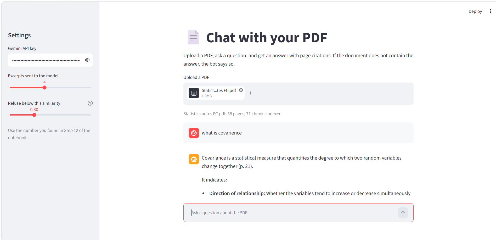

# Chat with Your PDF

A question-answering application for PDF documents using **Retrieval-Augmented Generation (RAG)**. Upload a PDF, ask questions in plain English, and receive context-based answers with page citations. If the document does not contain the answer, the application refuses to guess.

Built using Python, Google Gemini API, and Streamlit. Tested on a 38-page Statistics for Data Analytics PDF.

## App Screenshot



---

## Files in This Project

| File | Description |
|---|---|
| `chat_with_pdf_rag.ipynb` | Main notebook containing the complete 17-step RAG pipeline, including PDF loading, chunking, embeddings, retrieval, generation, refusal calibration, and evaluation. |
| `app_rag.py` | Streamlit web application for uploading PDFs, asking questions, and viewing source page citations. |
| `Statistics notes.pdf` | Sample document used to develop and test the project. |
| `rag_chunks.json` | Stores extracted text chunks, page numbers, and pipeline settings. |
| `rag_vectors.npy` | Stores the generated embeddings for each text chunk. |
| `index_Statistics notes_1000_200.npz` | Cached embeddings to avoid unnecessary API calls when rerunning the notebook. |
| `UI.png` | Screenshot of the running application. |
| `How to run.txt` | Quick setup and execution instructions. |
| `.ipynb_checkpoints/` | Automatically generated by Jupyter Notebook. Not required for the project. |

---

## How It Works

An LLM does not inherently know the contents of an uploaded PDF. This project uses **Retrieval-Augmented Generation (RAG)** to retrieve relevant document information before generating an answer.

### 1. PDF Loading
- Extracts text from PDFs page by page using `pypdf`.
- Preserves page numbers for accurate source citations.

### 2. Text Chunking
- Splits extracted text into chunks of approximately 1,000 characters.
- Uses 200-character overlapping sections to preserve context.
- Attempts to split at sentence boundaries.

### 3. Text Embedding
- Converts text chunks into numerical vectors using Google's `gemini-embedding-001`.
- Generates embeddings with 3,072 dimensions.
- Stores embeddings in a NumPy matrix.

### 4. Similarity-Based Retrieval
- Converts the user's question into an embedding.
- Calculates cosine similarity between the question and document chunks.
- Retrieves the top 4 most relevant chunks.

### 5. Relevance Checking and Refusal
- Checks the highest similarity score against a threshold of `0.67`.
- If the score is below the threshold, returns: "I couldn't find that in the document."
- Avoids unnecessary LLM calls for irrelevant questions.

### 6. Answer Generation
- Sends the question and retrieved document chunks to Gemini.
- Instructs the model to answer using only the retrieved context.
- Includes page citations such as `(p. 3)`.
- Instructs the model to refuse when the answer is not supported by the document.

---

## Settings Used

| Setting | Value |
|---|---|
| Chunk Size | 1,000 characters |
| Chunk Overlap | 200 characters |
| Total Chunks (Sample PDF) | 71 |
| Top-K Retrieved Chunks | 4 |
| Embedding Model | `gemini-embedding-001` |
| Generation Model | `gemini-3.5-flash` |
| Embedding Dimensions | 3,072 |
| Refusal Threshold | 0.67 (Cosine Similarity) |

### Refusal Threshold Calibration

The refusal threshold was selected by comparing similarity scores from answerable and out-of-scope questions.

- Lowest similarity score among answerable questions: `0.723`
- Highest similarity score among unanswerable questions: `0.618`
- Selected threshold: `0.67`

The threshold was calibrated using 11 questions, making it a reasonable initial setting rather than a universally validated value.

---

## Results

Tested the application using 7 manually created questions:
- 5 questions answerable from the PDF.
- 2 questions outside the document's scope.

Each generated answer was checked against the original source pages.

| Evaluation Metric | Result |
|---|---|
| Answerable Questions Answered Correctly | 5/5 |
| Out-of-Scope Questions Correctly Refused | 2/2 |

**Note:** This is a small, manually evaluated sanity check on a single document, not a standardized benchmark.

---

## How to Run

### 1. Clone the Repository

```bash
git clone <repository-url>
cd <project-folder>
```

### 2. Install Dependencies

```bash
python -m pip install google-genai pypdf numpy pandas streamlit
```

### 3. Get a Gemini API Key

Get a free API key from [Google AI Studio](https://aistudio.google.com).

**Important:** Do not hardcode your API key or upload it to GitHub.

### 4. Run the Jupyter Notebook

- Open `chat_with_pdf_rag.ipynb`.
- Set `PDF_PATH` in Step 2 to your PDF file.
- Run the notebook cells sequentially.
- Enter your Gemini API key when prompted in Step 3.

### 5. Run the Streamlit Application

From the project directory, execute:

```bash
python -m streamlit run app_rag.py
```

Paste your Gemini API key into the application sidebar, upload a PDF, and start asking questions.

---

## Tech Stack

- **Programming Language:** Python
- **LLM:** Google Gemini API
- **Embedding Model:** `gemini-embedding-001`
- **Generation Model:** `gemini-3.5-flash`
- **PDF Processing:** pypdf
- **Vector Operations:** NumPy
- **Data Processing:** Pandas
- **Similarity Measurement:** Cosine Similarity
- **Web Framework:** Streamlit
- **Environment:** Jupyter Notebook

## Skills Demonstrated

Python • Retrieval-Augmented Generation (RAG) • Large Language Models (LLMs) • Natural Language Processing (NLP) • Text Embeddings • Cosine Similarity • Semantic Search • Prompt Engineering • PDF Processing • Streamlit • Google Gemini API • Model Evaluation
